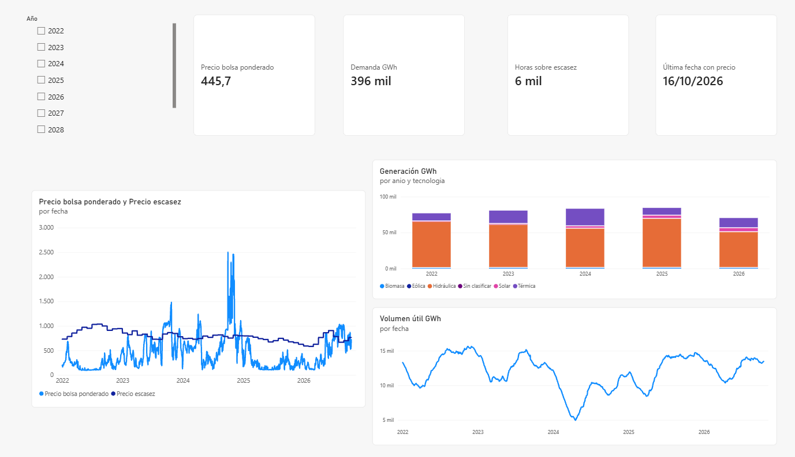
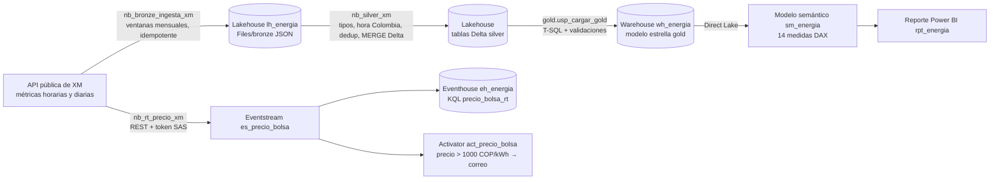
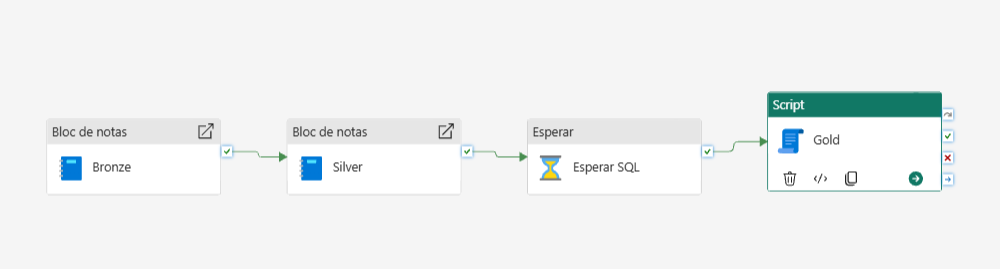
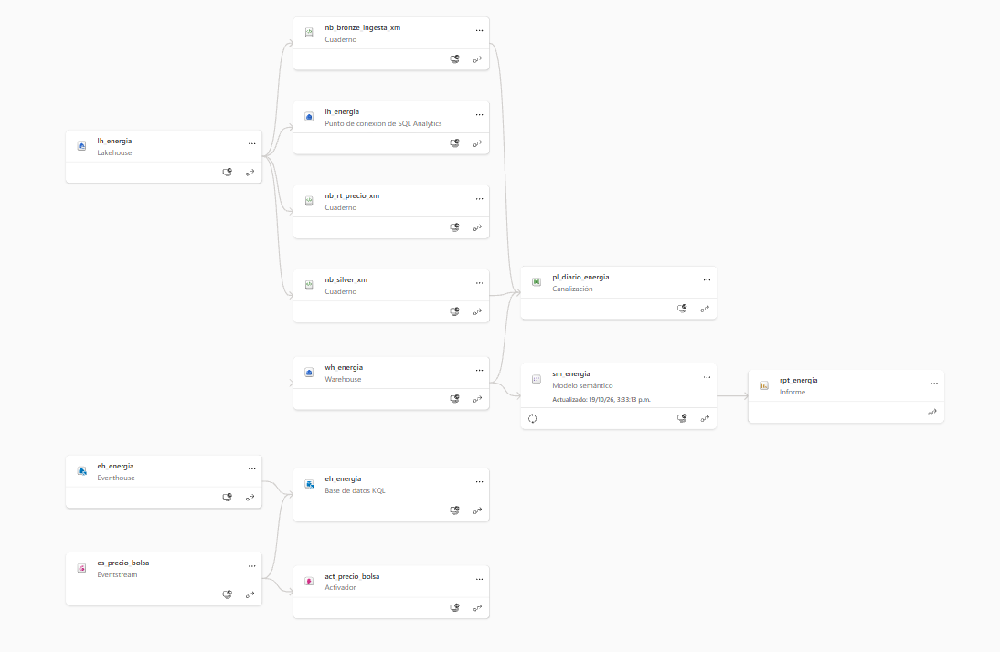

# Mercado eléctrico colombiano en Microsoft Fabric

[](https://github.com/samvie1232/colombia-energy-market-fabric/actions/workflows/ci.yml)  

Español · [English](README.md)

Plataforma de datos de punta a punta en **Microsoft Fabric** que carga a diario los datos del mercado eléctrico
mayorista de Colombia (XM, el operador del mercado) y responde: *¿cuándo y por qué sube el precio de bolsa?, ¿qué tanto
depende de la hidrología?, ¿qué peso tiene cada tecnología de generación?*, y avisa cuando el precio supera un umbral.

Proyecto de portafolio y práctica para la certificación **DP-700 (Fabric Data Engineer Associate)**.



## Arquitectura



| Capa | Elemento de Fabric | Qué hace |
| --- | --- | --- |
| Bronze | Lakehouse `lh_energia`, cuaderno `nb_bronze_ingesta_xm` | JSON crudo por métrica y ventana de fechas (`Files/bronze/xm/{métrica}/{cruce}/{inicio}_{fin}.json`). Repetir una ventana sobrescribe el mismo archivo, así que la carga es idempotente. Bitácora `bronze_ingesta_log`. |
| Silver | cuaderno `nb_silver_xm` | Tablas Delta tipadas, horas en hora de Colombia y UTC, deduplicadas por fecha de ingesta, `MERGE` solo cuando cambia el valor. Bitácora `silver_carga_log`. |
| Gold | Warehouse `wh_energia` (T-SQL) | Modelo estrella: `dim_fecha`, `dim_hora`, `dim_recurso`, `fct_precio_hora`, `fct_generacion_hora`, `fct_embalse_dia`, `fct_sistema_dia`. Validaciones (no nulos, unicidad por hora y recurso, rangos) en `calidad_resultados`. |
| Consumo | Modelo semántico `sm_energia` (Direct Lake), reporte `rpt_energia` | Precio de bolsa ponderado vs. precio de escasez, mezcla de generación por tecnología, volumen útil de embalses, variación frente al mes anterior. |
| Orquestación | Canalización `pl_diario_energia` | Bronze → Silver → espera → Gold, diaria a las 07:00 de Bogotá, 2 reintentos por actividad, parámetros `start_date`/`end_date` para backfill y correo si falla. Ver [docs/pipeline_diario.md](docs/pipeline_diario.md). |
| Tiempo real | Eventstream, Eventhouse, Activator | Un cuaderno programado envía como evento JSON cada precio horario nuevo que publica XM; Activator manda un correo cuando el precio sube de 1.000 COP/kWh. El modo `replay` reenvía un día histórico para demostraciones. |
| CI/CD | Integración Git, canalización de implementación, GitHub Actions | `energia-dev` está sincronizado con este repo (carpeta `fabric/`); una canalización de implementación pasa los elementos a `energia-prod`; Actions corre `ruff` y `pytest` en cada push. |





## Datos

- **Fuente:** API pública de XM (`servapibi.xm.com.co`, sin autenticación), desde 2022-01-01 (cubre El Niño 2023–2024).
  Contrato de datos con identificadores, granularidad, límites y retraso de publicación: [docs/data_contract.md](docs/data_contract.md).
- **Métricas:** precio de bolsa (`PrecBolsNaci`, horaria), demanda comercial (`DemaCome`, horaria), generación real por
  recurso (`Gene`, horaria), volumen útil de embalses (`VoluUtilDiarEner`, diaria), aportes hídricos (`AporEner`, diaria),
  precio de escasez (`PrecEsca`, diaria) y el maestro de recursos.
- **Volumen:** 349 ventanas mensuales en la carga histórica, 0 errores; unos 12,3 M de filas horarias de generación
  para 2.493 recursos.

## Resultados

- **Precio horario más alto del periodo: 2.675,65 COP/kWh el 2024-11-06**.
- Los embalses tocaron su punto más bajo a comienzos de 2024, en El Niño, el mismo periodo de precios altos sostenidos.
- La hidráulica es la tecnología dominante en todos los años. La térmica tuvo su mayor peso en 2024, con los embalses en
  su mínimo, y la solar crece a la vista en 2025–2026.
- Una corrida diaria completa tarda menos de 7 minutos (Bronze 1 min 18 s, Silver 2 min 39 s, espera 2 min, Gold 46 s).
- La alerta se probó repitiendo el 2024-11-06: 24 eventos llegaron al Eventhouse y Activator se disparó.

Son asociaciones observadas, no efectos causales: el precio también depende del costo de combustibles, salidas de
plantas, demanda y regulación, que este MVP no modela.

## Decisiones de diseño

- **Lakehouse para Bronze/Silver, Warehouse para Gold.** PySpark es la herramienta adecuada para leer JSON anidado y
  hacer `MERGE` en Delta; el modelo dimensional y sus validaciones se leen mejor en procedimientos T-SQL, que es como
  los mantendría un equipo de BI.
- **Direct Lake** en lugar de Import: el reporte lee directo las tablas Delta del Warehouse, sin paso de actualización
  del conjunto de datos ni copia duplicada.
- **Ventanas idempotentes** en lugar de solo marca de agua: cualquier rango se puede repetir (backfill o correcciones de
  XM) sin duplicados. La carga incremental recarga 7 días (Bronze/Silver) y 10 (Gold) porque XM corrige datos recientes.
- **Lógica de transformación como paquete Python** (`src/energia_xm`) con 25 pruebas, para probarla en CI fuera de Fabric.
- **Productor de tiempo real por HTTPS con token SAS** en lugar del SDK `azure-eventhub`: el cuaderno no instala
  paquetes. La cadena de conexión vive en un archivo del Lakehouse, nunca en el cuaderno ni en Git.
- **Regla de implementación para el modelo semántico.** Fabric reenlazó solos los cuadernos y la canalización a
  `energia-prod`, pero el modelo Direct Lake seguía leyendo el Warehouse de dev. Una regla de origen de datos en
  `sm_energia` (servidor y base de datos del Warehouse de producción) lo corrige en cada implementación; el error se
  detectó en la vista de linaje del área de trabajo.
- **Los elementos de tiempo real no pasan a producción.** Implementar el Eventstream crearía otro punto de conexión con
  otra clave, y un segundo Activator duplicaría las alertas. A `energia-prod` solo pasan el flujo batch y el reporte.
- **Costo:** todo corre en la capacidad de prueba de Fabric de 60 días, así que el proyecto costó USD 0. En una
  capacidad pagada usaría una F2 pausada fuera del horario de trabajo, con la canalización diaria y el cuaderno de
  tiempo real como únicos trabajos programados.

## Limitaciones

- **"Casi tiempo real":** XM publica el precio horario con unos 4 días de retraso, así que el evento llega cuando XM lo
  publica, no a la hora del despacho. El flujo de tiempo real es sobre todo una demostración de Eventstream, KQL y Activator.
- **Tenant de prueba:** la prueba de Fabric vence el 2026-12-18. El usuario del tenant no tiene buzón, así que los
  avisos de falla y de precio llegan a la cuenta del tenant; para recibirlos en un correo personal hay que invitarlo
  como usuario invitado en Entra ID.
- **Despliegue** con canalizaciones de implementación desde la interfaz. Desplegar desde GitHub Actions con
  `fabric-cicd` necesita una entidad de servicio; queda como mejora.
- **Datos en producción:** la canalización de implementación copia definiciones, no datos. Al implementar el Warehouse,
  Fabric compila sus procedimientos, y `usp_cargar_gold` referencia las tablas silver del Lakehouse; por eso en
  `energia-prod` hay que cargar primero Bronze y Silver (cuadernos con backfill) y después implementar el Warehouse,
  el modelo y el reporte.
- **Secretos:** la cadena de conexión del Eventstream es un archivo del Lakehouse con acceso limitado al área de
  trabajo. En un despliegue real iría en Azure Key Vault.
- **Retraso del punto SQL:** Gold lee Silver por el punto de conexión SQL del Lakehouse, que tarda en ver los datos
  nuevos de Delta; la canalización espera 2 minutos en lugar de llamar a la API de actualización de metadatos.
- Unos 3,1 M de valores horarios de generación llegan vacíos desde XM; Gold los guarda como 0 y Silver registra la alerta.
- `dim_fecha` llega hasta 2030, así que la segmentación por año muestra años futuros sin datos.

## Estructura del repositorio

```
fabric/              elementos de Fabric sincronizados por Git (cuadernos, lakehouse, warehouse, canalización, modelo, reporte)
notebooks/           copias .ipynb para importar en otra área de trabajo
src/energia_xm/      lógica de transformación y tiempo real con pruebas
tests/               pytest (25 pruebas; las de Spark corren en local)
warehouse/gold/      T-SQL: tablas, validaciones, procedimiento de carga
semantic_model/      medidas DAX
docs/                contrato de datos, guía de la canalización, capturas
scripts/             exploración de la API de XM
```

## Cómo reproducirlo

1. Crea un área de trabajo de Fabric, conéctala a un fork de este repo (integración Git, carpeta `fabric/`) y sincroniza.
2. Corre `pl_diario_energia` con `start_date = 2022-01-01` para la carga histórica.
3. Para la alerta: crea el Eventstream con origen de punto de conexión personalizado, guarda su cadena de conexión como
   `Files/secretos/es_precio_bolsa.txt` en `lh_energia` y corre `nb_rt_precio_xm` con `modo = "replay"`.

Pruebas en local:

```bash
pip install -e ".[dev]"
ruff check . && pytest -v
```

## Autor

Santiago Andrés Martínez Vidal, Data Engineer (Cali, Colombia). Datos: XM S.A. E.S.P.
