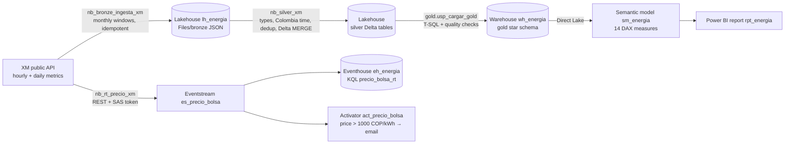

# Colombian electricity market on Microsoft Fabric

[](https://github.com/samvie1232/colombia-energy-market-fabric/actions/workflows/ci.yml)  

[Español](README.es.md) · English

End-to-end data platform on **Microsoft Fabric** that loads Colombia's wholesale electricity market data
(XM, the market operator) every day and answers: *when and why does the spot price spike, how much does it
depend on hydrology, what is the weight of each generation technology*, and sends an alert when the price
crosses a threshold.

Built as a portfolio project and as hands-on practice for the **DP-700 (Fabric Data Engineer Associate)** exam.


## Architecture



| Layer | Fabric item | What it does |
| --- | --- | --- |
| Bronze | Lakehouse `lh_energia`, notebook `nb_bronze_ingesta_xm` | Raw JSON per metric and date window (`Files/bronze/xm/{metric}/{entity}/{start}_{end}.json`). Re-running a window overwrites the same file, so loads are idempotent. Log table `bronze_ingesta_log`. |
| Silver | notebook `nb_silver_xm` | Typed Delta tables, hours converted to Colombia time and UTC, deduplicated by ingestion time, `MERGE` only when a value changed. Log table `silver_carga_log`. |
| Gold | Warehouse `wh_energia` (T-SQL) | Star schema: `dim_fecha`, `dim_hora`, `dim_recurso`, `fct_precio_hora`, `fct_generacion_hora`, `fct_embalse_dia`, `fct_sistema_dia`. Quality checks (not null, uniqueness per hour and resource, ranges) logged to `calidad_resultados`. |
| Serving | Semantic model `sm_energia` (Direct Lake), report `rpt_energia` | Weighted spot price vs scarcity price, generation mix by technology, reservoir storage, month-over-month variation. |
| Orchestration | Data pipeline `pl_diario_energia` | Bronze → Silver → wait → Gold, daily 07:00 Bogotá, 2 retries per activity, `start_date`/`end_date` parameters for backfill, email on failure. See [docs/pipeline_diario.md](docs/pipeline_diario.md). |
| Real time | Eventstream, Eventhouse, Activator | A scheduled notebook pushes each newly published hourly price as a JSON event; Activator emails when the price rises above 1,000 COP/kWh. A `replay` mode re-sends a historical day for demos. |
| CI/CD | Git integration, deployment pipeline, GitHub Actions | `energia-dev` is synced to this repo (`fabric/` folder); a deployment pipeline promotes items to `energia-prod`; Actions runs `ruff` and `pytest` on every push. |


## Data

- **Source:** XM public API (`servapibi.xm.com.co`, no authentication), from 2022-01-01 (covers El Niño 2023–2024).
  Full data contract with metric IDs, granularity, limits and publication lag: [docs/data_contract.md](docs/data_contract.md).
- **Metrics:** spot price (`PrecBolsNaci`, hourly), commercial demand (`DemaCome`, hourly), actual generation per
  resource (`Gene`, hourly), useful reservoir volume (`VoluUtilDiarEner`, daily), hydro inflows (`AporEner`, daily),
  scarcity price (`PrecEsca`, daily) and the resource master list.
- **Volume:** 349 monthly windows in the historical backfill with 0 errors; about 12.3 M hourly generation rows for
  2,493 resources.

## Results

- **Highest hourly spot price in the period: 2,675.65 COP/kWh on 2024-11-06**.
- Reservoir storage hit its lowest point in early 2024, during El Niño, the same period with the highest sustained prices.
- Hydro is the dominant generation technology in every year. Thermal had its largest share in 2024, when reservoirs were
  lowest, and solar grows visibly in 2025–2026.
- A full daily run takes under 7 minutes (Bronze 1 min 18 s, Silver 2 min 39 s, wait 2 min, Gold 46 s).
- The alert was tested by replaying 2024-11-06: 24 events reached the Eventhouse and Activator fired.

These are observed associations, not causal effects: price also depends on fuel costs, plant outages, demand and
regulation, which this MVP does not model.

## Design decisions

- **Lakehouse for Bronze/Silver, Warehouse for Gold.** PySpark is the right tool to parse nested JSON and `MERGE` into
  Delta; the dimensional model and its quality checks read more clearly in T-SQL stored procedures, which is also how
  a BI team would maintain them.
- **Direct Lake** instead of Import: the report reads the Warehouse Delta tables directly, so there is no dataset
  refresh step and no duplicated copy of the data.
- **Idempotent windows** instead of watermark-only loads: any date range can be re-run (backfill or XM corrections)
  without duplicates. Incremental runs reload the last 7 days (Bronze/Silver) and 10 days (Gold) because XM revises
  recent data.
- **Transformation logic as a Python package** (`src/energia_xm`) with 25 tests, so it can be tested in CI outside
  Fabric.
- **Real-time producer over HTTPS with a SAS token** instead of the `azure-eventhub` SDK: no package installs in the
  notebook. The connection string lives in a Lakehouse file, never in the notebook or in Git.
- **Deployment rule for the semantic model.** Fabric rebound the notebooks and the pipeline to `energia-prod` on its own,
  but the Direct Lake model kept reading the dev Warehouse. A data source rule on `sm_energia` (server and database of
  the production Warehouse) fixes it on every deployment; the workspace lineage view is how this was caught.
- **Real-time items are not promoted to production.** Deploying the Eventstream would create a second endpoint with a
  new key, and a second Activator would duplicate the alerts. Only the batch flow and the report go to `energia-prod`.
- **Cost:** everything runs on the 60-day Fabric trial capacity, so the project cost USD 0. On a paid capacity the
  plan would be an F2 paused outside working hours, with the daily pipeline and the real-time notebook as the only
  scheduled jobs.

## Limitations

- **"Near real time":** XM publishes hourly prices with a lag of about 4 days, so an event arrives when XM publishes
  it, not at dispatch time. The real-time path is mainly a demonstration of Eventstream, KQL and Activator.
- **Trial tenant:** the Fabric trial ends on 2026-12-18. The tenant user has no mailbox, so failure and price alerts
  go to the tenant account; sending them to a personal address requires inviting it as a guest in Entra ID.
- **Deployment** uses Fabric deployment pipelines from the UI. Deploying from GitHub Actions with `fabric-cicd` needs a
  service principal, left as an improvement.
- **Production data:** deployment pipelines copy item definitions, not data. The Warehouse deployment compiles its
  stored procedures, and `usp_cargar_gold` references Silver tables in the Lakehouse, so `energia-prod` needs Bronze and
  Silver loaded (notebooks with a backfill) before the Warehouse, model and report can be deployed.
- **Secrets:** the Eventstream connection string is a Lakehouse file restricted to the workspace. A real deployment
  would use Azure Key Vault.
- **SQL endpoint lag:** Gold reads Silver through the Lakehouse SQL endpoint, which takes a moment to see new Delta
  data; the pipeline waits 2 minutes instead of calling the metadata refresh API.
- About 3.1 M hourly generation values arrive empty from XM; Gold stores them as 0 and Silver logs the alert.
- `dim_fecha` runs to 2030, so the year slicer lists future years with no data.

## Repository layout

```
fabric/              Fabric items synced by Git integration (notebooks, lakehouse, warehouse, pipeline, model, report)
notebooks/           .ipynb copies for importing into a new workspace
src/energia_xm/      tested transformation and real-time logic
tests/               pytest (25 tests, Spark tests run locally)
warehouse/gold/      T-SQL: tables, quality checks, load procedure
semantic_model/      DAX measures
docs/                data contract, daily pipeline guide, screenshots
scripts/             XM API exploration
```

## Run it

1. Create a Fabric workspace, connect it to a fork of this repo (Git integration, folder `fabric/`) and sync.
2. Run `pl_diario_energia` with `start_date = 2022-01-01` for the historical backfill.
3. For the alert: create the Eventstream with a custom endpoint source, save its connection string as
   `Files/secretos/es_precio_bolsa.txt` in `lh_energia`, and run `nb_rt_precio_xm` with `modo = "replay"`.

Local tests:

```bash
pip install -e ".[dev]"
ruff check . && pytest -v
```

## Author

Santiago Andrés Martínez Vidal, Data Engineer (Cali, Colombia). Data: XM S.A. E.S.P.
